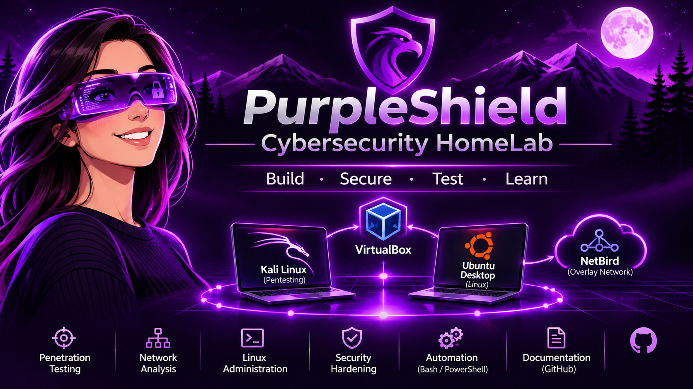
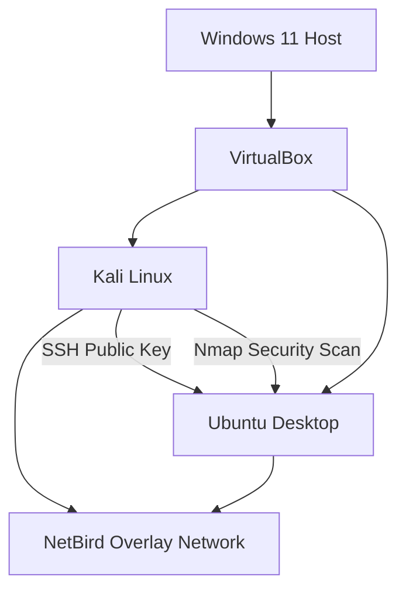

# 🛡️ PurpleShield – Cybersecurity HomeLab

## 01 | Projektübersicht

PurpleShield ist mein persönliches IT- und Cybersecurity-HomeLab, das ich im Rahmen meiner Umschulung zur Fachinformatikerin für Systemintegration entwickle.

Das Projekt dient der praktischen Vertiefung meiner Kenntnisse in den Bereichen Netzwerktechnik, Virtualisierung, Linux-Administration und IT-Sicherheit.

## 02 | Projektziele

- Aufbau einer virtuellen IT-Infrastruktur
- Konfiguration virtueller Netzwerke
- Einrichtung sicherer Remote-Verbindungen
- Administration von Linux-Systemen
- Durchführung kontrollierter Sicherheitsanalysen
- Systematische Fehleranalyse und Dokumentation

## 03 | Technologien

| Technologie | Einsatzbereich |
|---|---|
| Windows 11 | Host-System |
| VirtualBox | Virtualisierung |
| Kali Linux | Sicherheitsanalyse |
| Ubuntu Desktop | Linux-Testsystem |
| NetBird | Privates Overlay-Netzwerk |
| OpenSSH | Sicherer Remote-Zugriff |
| Nmap | Netzwerk- und Portanalyse |
| Bash | Linux-Administration |
| GitHub | Projektdokumentation |

## 04 | Netzwerkarchitektur

## 05 | Implementierung

### Phase 1 – Virtualisierung

- Installation und Konfiguration von VirtualBox
- Einrichtung einer Kali-Linux-VM
- Einrichtung einer Ubuntu-Desktop-VM
- Konfiguration virtueller Netzwerkadapter

### Phase 2 – Netzwerkkonfiguration

- Analyse der Netzwerkschnittstellen
- Konfiguration der Netzwerkverbindungen
- Überprüfung der IP-Konfiguration
- Durchführung von Konnektivitätstests
- Fehleranalyse bei Netzwerkproblemen

### Phase 3 – Private Netzwerkinfrastruktur

- Installation von NetBird
- Verbindung der virtuellen Maschinen
- Aufbau eines privaten Overlay-Netzwerks
- Überprüfung der Erreichbarkeit

### Phase 4 – Sicherer SSH-Zugriff

- Installation und Konfiguration von OpenSSH
- Erstellung eines ED25519-Schlüsselpaars
- Einrichtung der Public-Key-Authentifizierung
- Erfolgreicher Remote-Zugriff von Kali auf Ubuntu

### Phase 5 – Netzwerkanalyse

- Durchführung kontrollierter Nmap-Scans
- Identifikation erreichbarer Netzwerkdienste
- Analyse offener TCP- und UDP-Ports
- Bewertung der Netzwerkverbindungen

## 06 | Projektstatus

| Aufgabe | Status |
|---|---|
| Virtualisierung | ✅ Abgeschlossen |
| Linux-Installation | ✅ Abgeschlossen |
| Netzwerkkonfiguration | ✅ Abgeschlossen |
| NetBird-Integration | ✅ Abgeschlossen |
| SSH Public-Key Authentication | ✅ Abgeschlossen |
| Nmap-Netzwerkanalyse | ✅ Abgeschlossen |
| Technische Dokumentation | 🟡 In Bearbeitung |
| Linux Hardening | ⚪ Geplant |
| Firewall-Konfiguration | ⚪ Geplant |
| Security Monitoring | ⚪ Geplant |

## 07 | Erworbene Kompetenzen

- Virtualisierung und Systemintegration
- Linux-Systemadministration
- TCP/IP und Netzwerkdiagnose
- Sichere Remote-Administration
- SSH-Schlüsselverwaltung
- Netzwerk- und Portanalyse
- Systematische Fehlerbehebung
- Technische Projektdokumentation

## 08 | Geplante Erweiterungen

- Linux Server Hardening
- Firewall und Netzwerksegmentierung
- Automatisierung mit Bash und PowerShell
- Vulnerability Assessment
- Zentrales Security Monitoring
- Integration weiterer virtueller Systeme

## 09 | Sicherheit und Datenschutz

Alle Sicherheitstests werden ausschließlich innerhalb meiner eigenen, autorisierten Laborumgebung durchgeführt.

Sensible Informationen, Zugangsdaten, private Schlüssel und persönliche Netzwerkkonfigurationen werden nicht veröffentlicht.

## 10 | Über mich

Angehende Fachinformatikerin für Systemintegration mit eJPT-Zertifizierung und besonderem Interesse an IT-Infrastruktur, Cybersecurity und Penetration Testing.

Dieses Projekt dokumentiert meine kontinuierliche technische Weiterentwicklung.

---

**PurpleShield | Build. Secure. Test. Learn.**

> Hack the box, build the box, explain it simply.
