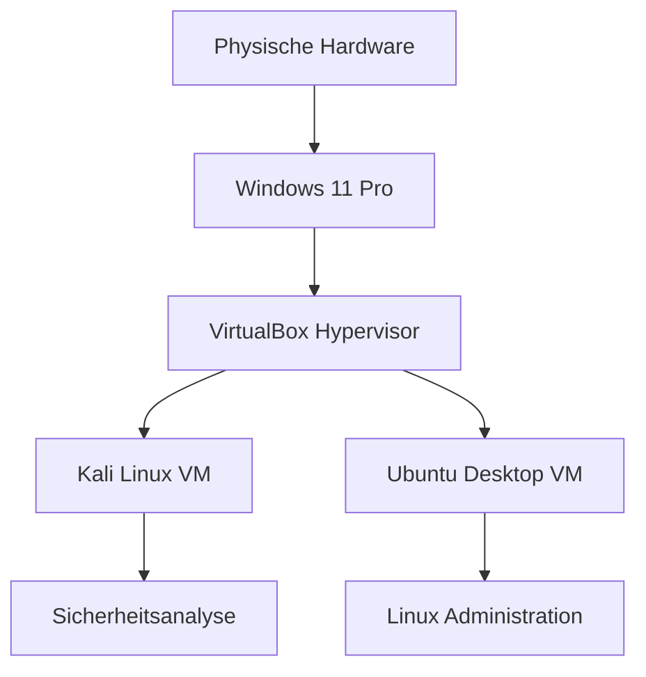

# 02 | Virtualisierung

**Projekt:** PurpleShield – Cybersecurity HomeLab  
**Projektphase:** Aufbau der virtuellen Infrastruktur  
**Status:** Abgeschlossen  

---

## 1. Zielsetzung

Ziel dieser Projektphase ist der Aufbau einer virtuellen Laborumgebung, in der unterschiedliche Betriebssysteme unabhängig voneinander betrieben, administriert und getestet werden können.

Als Virtualisierungsplattform wird Oracle VirtualBox eingesetzt.

## 2. Auswahl der Virtualisierungsplattform

VirtualBox wurde aus folgenden Gründen ausgewählt:

- Kostenlose Nutzung
- Unterstützung verschiedener Betriebssysteme
- Flexible Ressourcenzuweisung
- Konfigurierbare virtuelle Netzwerkadapter
- Unterstützung von Snapshots
- Einfache Erweiterbarkeit der Laborumgebung

VirtualBox ist ein Typ-2-Hypervisor, der auf einem bestehenden Host-Betriebssystem ausgeführt wird.

## 3. Virtuelle Infrastruktur



## 4. Host-System

| Komponente | Konfiguration |
|---|---|
| Betriebssystem | Windows 11 Pro |
| Prozessor | Intel Core i7 |
| Arbeitsspeicher | 16 GB RAM |
| Datenträger | SSD |
| Hypervisor | Oracle VirtualBox |

## 5. Virtuelle Maschine – Kali Linux

### Verwendungszweck

Kali Linux dient als System für kontrollierte Netzwerk- und Sicherheitsanalysen.

### Einsatzbereiche

- Netzwerkdiagnose
- Portscanning
- Penetration Testing
- Schwachstellenanalyse
- Linux-Kommandozeile
- SSH-Client

### Installation

1. Kali-Linux-Installationsmedium bereitstellen.
2. Virtuelle Maschine in VirtualBox erstellen.
3. Virtuelle Hardware konfigurieren.
4. Betriebssystem installieren.
5. Benutzerkonto einrichten.
6. System starten und aktualisieren.
7. Netzwerkverbindung überprüfen.

### Systemaktualisierung

```bash
sudo apt update
sudo apt upgrade -y
```

Der erste Befehl aktualisiert die Paketlisten. Der zweite installiert verfügbare Aktualisierungen.

## 6. Virtuelle Maschine – Ubuntu Desktop

### Verwendungszweck

Ubuntu dient als Linux-Administrationssystem und autorisiertes Testsystem innerhalb der Laborumgebung.

### Systemkonfiguration

| Komponente | Konfiguration |
|---|---|
| Betriebssystem | Ubuntu 24.04 LTS |
| Arbeitsspeicher | Ca. 4 GB |
| Virtueller Datenträger | Ca. 25 GB nutzbar |
| Netzwerk | Virtueller Netzwerkadapter |
| Funktion | Administrations- und Testsystem |

### Installation

1. Ubuntu-Installationsmedium bereitstellen.
2. Virtuelle Maschine erstellen.
3. Arbeitsspeicher und Datenträger konfigurieren.
4. Ubuntu Desktop installieren.
5. Benutzerkonto einrichten.
6. Systemaktualisierungen durchführen.
7. Netzwerkfunktion überprüfen.

## 7. Systemüberprüfung

Zur Überprüfung der installierten Linux-Systeme werden folgende Befehle verwendet:

| Befehl | Funktion |
|---|---|
| `hostnamectl` | Systeminformationen anzeigen |
| `cat /etc/os-release` | Betriebssystemversion anzeigen |
| `uname -r` | Kernelversion anzeigen |
| `free -h` | Arbeitsspeicher überprüfen |
| `df -h` | Datenträgerauslastung überprüfen |
| `lsblk` | Blockgeräte anzeigen |
| `ip a` | Netzwerkschnittstellen anzeigen |

## 8. VirtualBox Guest Additions

Die Guest Additions verbessern die Integration zwischen Host- und Gastbetriebssystem.

Mögliche Funktionen:

- Automatische Bildschirmauflösung
- Gemeinsame Zwischenablage
- Verbesserte Maussteuerung
- Gemeinsame Ordner
- Verbesserte grafische Darstellung

Gemeinsame Ordner und Zwischenablage sollten bei sicherheitskritischen Testsystemen nur bei Bedarf aktiviert werden.

## 9. Aufgetretene Probleme

### Problem 1 – Bildschirmauflösung

Die Bildschirmauflösung der Kali-Linux-VM passte sich zunächst nicht automatisch an die Fenstergröße an.

Die Darstellung wurde durch Anpassungen innerhalb der virtuellen Umgebung korrigiert.

### Problem 2 – Netzwerkverbindung

Nach der Einrichtung von Kali Linux war die Netzwerkverbindung zunächst nicht funktionsfähig.

Die Netzwerkschnittstellen wurden analysiert und die Netzwerkverbindung wurde wiederhergestellt.

Die detaillierte Fehleranalyse wird in einer separaten Projektdokumentation beschrieben.

## 10. Sicherheitsmaßnahmen

Für den sicheren Betrieb der virtuellen Laborumgebung sind folgende Maßnahmen vorgesehen:

- Regelmäßige Systemaktualisierungen
- Verwendung kontrollierter Netzwerkverbindungen
- Erstellung von Snapshots vor kritischen Änderungen
- Beschränkung von Host-Gast-Freigaben
- Schutz von Zugangsdaten
- Durchführung von Sicherheitstests ausschließlich auf autorisierten Systemen

## 11. Funktionstest

| Test | Erwartetes Ergebnis | Status |
|---|---|---|
| VirtualBox starten | Hypervisor verfügbar | Bestanden |
| Kali Linux starten | Betriebssystem funktionsfähig | Bestanden |
| Ubuntu starten | Betriebssystem funktionsfähig | Bestanden |
| Netzwerkverbindung | Kommunikation möglich | Bestanden |
| Bildschirmdarstellung Kali | Nutzbare Darstellung | Bestanden |

## 12. Fazit

Mit der erfolgreichen Einrichtung von Kali Linux und Ubuntu Desktop wurde die Grundlage für die weitere Entwicklung des PurpleShield HomeLabs geschaffen.

Während dieser Projektphase konnte ich praktische Erfahrungen in der Virtualisierung, Betriebssysteminstallation, Ressourcenzuweisung und technischen Fehleranalyse sammeln.

Die virtuelle Infrastruktur dient als Basis für die nachfolgende Netzwerkkonfiguration und Sicherheitsanalyse.

---

[Zurück zur Projektübersicht](../README.md)

[Vorherige Phase – Projektplanung](01-project-planning.md)

**PurpleShield | Build. Secure. Test. Learn.**
