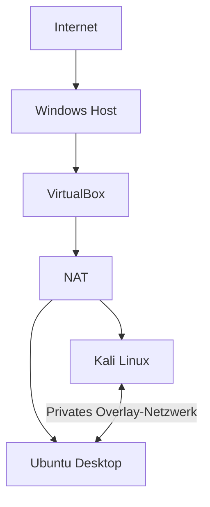

# 03 | Netzwerkkonfiguration

**Projekt:** PurpleShield – Cybersecurity HomeLab  
**Projektphase:** Netzwerkinfrastruktur  
**Status:** Abgeschlossen  

---

## 1. Zielsetzung

Ziel dieser Projektphase ist die Einrichtung einer funktionsfähigen Netzwerkkommunikation innerhalb der virtuellen Laborumgebung.

Dabei werden virtuelle Netzwerkadapter konfiguriert, IP-Adressen analysiert, Netzwerkverbindungen überprüft und auftretende Netzwerkprobleme systematisch behoben.

## 2. Netzwerkgrundlagen

Für die Konfiguration der Laborumgebung sind folgende Netzwerkkomponenten relevant:

| Komponente | Funktion |
|---|---|
| IP-Adresse | Logische Adressierung eines Netzwerkgeräts |
| MAC-Adresse | Identifikation einer Netzwerkschnittstelle |
| Subnetzmaske | Unterteilung eines IP-Netzwerks |
| Default Gateway | Weiterleitung in andere Netzwerke |
| DNS | Namensauflösung |
| DHCP | Automatische IP-Konfiguration |
| NAT | Übersetzung von Netzwerkadressen |
| Netzwerkadapter | Verbindung eines Systems mit dem Netzwerk |

## 3. Virtuelle Netzwerkmodi

VirtualBox unterstützt unterschiedliche Netzwerkmodi.

| Netzwerkmodus | Funktion |
|---|---|
| NAT | Internetzugriff über das Host-System |
| NAT-Netzwerk | Kommunikation zwischen VMs und Internetzugriff |
| Netzwerkbrücke | Direkte Einbindung in das physische Netzwerk |
| Host-only | Kommunikation zwischen Host und virtuellen Maschinen |
| Internes Netzwerk | Kommunikation zwischen VMs innerhalb eines virtuellen Netzwerks |

### NAT

Network Address Translation ermöglicht virtuellen Maschinen den Zugriff auf externe Netzwerke über das Host-System.

Vorteile:

- Einfache Konfiguration
- Internetzugriff für Systemaktualisierungen
- Keine direkte Erreichbarkeit aus externen Netzwerken ohne zusätzliche Konfiguration
- Geringerer Konfigurationsaufwand

### Host-only-Netzwerk

Ein Host-only-Netzwerk ermöglicht die Kommunikation zwischen dem Host-System und den angeschlossenen virtuellen Maschinen.

Dieser Netzwerkmodus stellt standardmäßig keinen direkten Internetzugriff bereit.

## 4. Netzwerkarchitektur

Die folgende Darstellung zeigt das vereinfachte Netzwerkkonzept der Laborumgebung.



Die direkte Kommunikation zwischen den virtuellen Maschinen wird über NetBird realisiert.

Die detaillierte NetBird-Konfiguration wird in der nächsten Projektphase dokumentiert.

## 5. Netzwerkschnittstellen analysieren

Unter Linux stehen verschiedene Werkzeuge zur Überprüfung der Netzwerkkonfiguration zur Verfügung.

### IP-Konfiguration anzeigen

```bash
ip a
```

Dieser Befehl zeigt:

- Vorhandene Netzwerkschnittstellen
- IPv4- und IPv6-Adressen
- MAC-Adressen
- Status der Schnittstellen
- Zugehörige Netzwerkpräfixe

### Routing-Tabelle anzeigen

```bash
ip route
```

Die Routing-Tabelle enthält Informationen darüber, über welche Schnittstelle und welches Gateway Netzwerkpakete weitergeleitet werden.

### Netzwerkgeräte überprüfen

```bash
nmcli device status
```

Dieser Befehl zeigt den Verbindungsstatus der durch NetworkManager verwalteten Netzwerkgeräte.

### Netzwerkverbindungen anzeigen

```bash
nmcli connection show
```

Hiermit können vorhandene Netzwerkprofile überprüft werden.

## 6. Aufgetretenes Netzwerkproblem

### Fehlerbeschreibung

Nach der Installation von Kali Linux war zunächst keine funktionsfähige Internetverbindung vorhanden.

Eine Netzwerkschnittstelle wurde als nicht verbunden angezeigt, während eine weitere Schnittstelle dem Host-only-Netzwerk zugeordnet war.

### Fehleranalyse

Zur Untersuchung des Problems wurden folgende Befehle eingesetzt:

```bash
ip a
ip route
nmcli device status
nmcli connection show
```

Dabei wurden folgende Punkte überprüft:

- Status der Netzwerkschnittstellen
- Vorhandene IP-Adressen
- Aktive Netzwerkverbindungen
- Standardroute
- Zuordnung der virtuellen Netzwerkadapter

### Fehlerursache

Die für den Internetzugriff benötigte Netzwerkschnittstelle war nicht aktiv verbunden.

Dadurch konnte keine reguläre Netzwerkkommunikation über diese Schnittstelle stattfinden.

### Fehlerbehebung

Die Netzwerkverbindung wurde mithilfe von NetworkManager wiederhergestellt.

Beispiel für die Aktivierung einer Netzwerkschnittstelle:

```bash
sudo nmcli device connect eth0
```

Anschließend wurde die Netzwerkkonfiguration erneut überprüft:

```bash
ip a
ip route
nmcli device status
```

### Ergebnis

Nach der Wiederherstellung der Netzwerkverbindung waren erfolgreiche Konnektivitätstests möglich.

## 7. Konnektivitätstests

### Test 1 – IP-Erreichbarkeit

```bash
ping -c 4 1.1.1.1
```

Dieser Test überprüft die Erreichbarkeit einer externen IP-Adresse.

### Test 2 – DNS-Namensauflösung

```bash
getent hosts example.com
```

Dieser Befehl überprüft, ob ein Domainname in eine IP-Adresse aufgelöst werden kann.

### Test 3 – Internetverbindung

```bash
curl -I https://example.com
```

Dieser Test überprüft die Erreichbarkeit eines externen Webservers über HTTPS.

### Test 4 – Kommunikation zwischen Laborsystemen

```bash
ping -c 4 <LAB-PEER-IP>
```

Die Platzhalteradresse muss durch die tatsächliche Adresse des autorisierten Laborsystems ersetzt werden.

## 8. Systematische Netzwerkdiagnose

Die Fehleranalyse erfolgt schrittweise anhand des OSI-Modells.

| OSI-Schicht | Überprüfung |
|---|---|
| Layer 1 – Physical | Virtueller Adapter und Verbindungsstatus |
| Layer 2 – Data Link | Netzwerkschnittstelle und MAC-Adresse |
| Layer 3 – Network | IP-Adresse, Routing und Gateway |
| Layer 4 – Transport | TCP- und UDP-Verbindungen |
| Layer 7 – Application | DNS, SSH und HTTP/HTTPS |

Durch diese Vorgehensweise können Netzwerkprobleme gezielt eingegrenzt werden.

## 9. Testprotokoll

| Test | Erwartetes Ergebnis | Status |
|---|---|---|
| Netzwerkschnittstellen erkennen | Schnittstellen vorhanden | Bestanden |
| Netzwerkverbindung aktivieren | Schnittstelle verbunden | Bestanden |
| IP-Konfiguration überprüfen | Gültige IP-Konfiguration | Bestanden |
| Internetverbindung wiederherstellen | Externe Erreichbarkeit | Bestanden |
| Kommunikation zwischen Laborsystemen | Systeme erreichbar | Bestanden |
| Separater DNS-Test | Erfolgreiche Namensauflösung | Nachzutragen |
| Separater HTTPS-Test | HTTP-Antwort erhalten | Nachzutragen |

## 10. Sicherheitsaspekte

Bei der Konfiguration virtueller Netzwerke werden folgende Sicherheitsaspekte berücksichtigt:

- Keine unnötigen Portweiterleitungen
- Keine unbeabsichtigte Freigabe von Testsystemen
- Kontrollierte Netzwerkkommunikation
- Trennung von Labor- und produktiven Systemen
- Schutz persönlicher Netzwerkdaten
- Sicherheitstests ausschließlich auf autorisierten Systemen

NAT allein ersetzt keine vollständige Firewall- oder Sicherheitskonfiguration.

Eine weiterführende Netzwerksegmentierung ist für eine spätere Projektphase vorgesehen.

## 11. Datenschutz und Anonymisierung

Aus Sicherheitsgründen werden folgende Informationen nicht veröffentlicht:

- Tatsächliche öffentliche IP-Adressen
- Persönliche interne Netzwerkadressen
- MAC-Adressen
- Individuelle Hostnamen
- Zugangsdaten
- Private Schlüssel
- Vertrauliche Netzwerkkonfigurationen

In öffentlichen Beispielen werden stattdessen Platzhalter oder neutrale Beispieladressen verwendet.

## 12. Erworbene Kompetenzen

- Konfiguration virtueller Netzwerkadapter
- Verständnis verschiedener Netzwerkmodi
- IPv4-Adressierung
- Routing und Default Gateway
- NAT und DHCP
- Linux-Netzwerkadministration
- NetworkManager und nmcli
- Netzwerkdiagnose
- Systematische Fehlerbehebung anhand des OSI-Modells

## 13. Fazit

Während dieser Projektphase konnte ich meine theoretischen Kenntnisse der Netzwerktechnik praktisch anwenden.

Ein aufgetretenes Verbindungsproblem innerhalb der Kali-Linux-VM wurde durch die Analyse der Netzwerkschnittstellen und die Wiederherstellung der Netzwerkverbindung behoben.

Die funktionsfähige Netzwerkinfrastruktur bildet die Grundlage für die private Vernetzung der virtuellen Maschinen mittels NetBird.

---

[Zurück zur Projektübersicht](../README.md)

[Vorherige Phase – Virtualisierung](02-virtualization.md)

**PurpleShield | Build. Secure. Test. Learn.**
