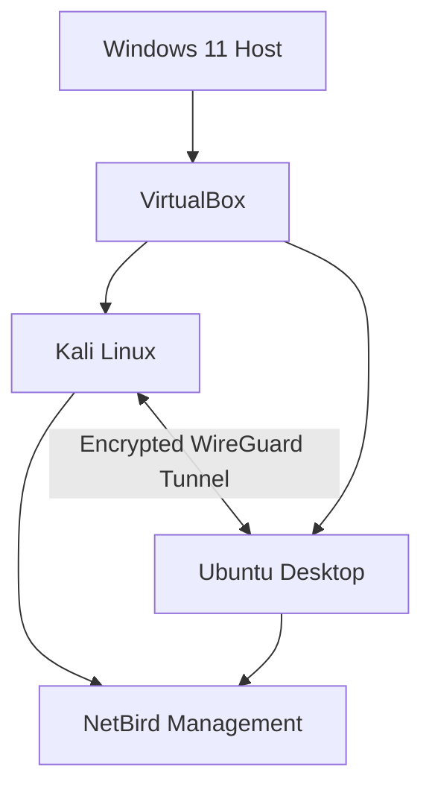

# 04 | NetBird-Integration

**Projekt:** PurpleShield – Cybersecurity HomeLab  
**Projektphase:** Private Netzwerkinfrastruktur  
**Status:** Abgeschlossen  

---

## 1. Zielsetzung

Ziel dieser Projektphase ist der Aufbau einer privaten, verschlüsselten Netzwerkverbindung zwischen den virtuellen Maschinen Kali Linux und Ubuntu Desktop.

Die Systeme sollen unabhängig von ihrer lokalen Netzwerkkonfiguration miteinander kommunizieren können, ohne SSH-Dienste direkt über das öffentliche Internet bereitzustellen.

## 2. Was ist NetBird?

NetBird ist eine auf WireGuard basierende Mesh-VPN-Lösung, mit der private Overlay-Netzwerke aufgebaut und verwaltet werden können.

Die Kommunikation zwischen den verbundenen Geräten erfolgt verschlüsselt.

### Vorteile

- Verschlüsselte Netzwerkkommunikation
- Zentrale Geräteverwaltung
- Automatische Peer-Erkennung
- NAT-Traversal
- Zugriffssteuerung durch Access Policies
- Unterstützung unterschiedlicher Betriebssysteme
- Keine manuelle Portweiterleitung für SSH erforderlich

## 3. Technische Grundlagen

| Begriff | Beschreibung |
|---|---|
| VPN | Virtuelles privates Netzwerk |
| WireGuard | Modernes VPN-Protokoll |
| Overlay Network | Logisches Netzwerk über einer bestehenden Infrastruktur |
| Peer | Teilnehmer innerhalb des VPN-Netzwerks |
| Mesh Network | Netzwerk mit direkten Verbindungen zwischen Teilnehmern |
| NAT-Traversal | Aufbau von Verbindungen über NAT-Grenzen hinweg |
| Relay | Vermittlung bei nicht möglichen Direktverbindungen |
| Access Policy | Regel zur Steuerung von Netzwerkzugriffen |
| FQDN | Vollständig qualifizierter Domainname |

## 4. Netzwerkarchitektur



NetBird verwaltet die Verbindung zwischen den Peers.

Wenn eine direkte Verbindung nicht möglich ist, kann die verschlüsselte Kommunikation über einen Relay-Dienst erfolgen.

## 5. Installation

NetBird wurde auf beiden Linux-Systemen installiert.

Die Installation kann beispielsweise über das offizielle Installationsskript erfolgen.

```bash
curl -fsSL https://pkgs.netbird.io/install.sh -o netbird-install.sh
```

Vor der Ausführung sollte das heruntergeladene Skript überprüft werden.

```bash
less netbird-install.sh
```

Anschließend kann die Installation durchgeführt werden.

```bash
sudo bash netbird-install.sh
```

Offizielle Dokumentation:

https://docs.netbird.io/

## 6. Verbindung mit NetBird

Nach der Installation werden beide Systeme mit dem privaten NetBird-Netzwerk verbunden.

```bash
sudo netbird up
```

Der Befehl startet den Verbindungsaufbau und gegebenenfalls den Authentifizierungsprozess.

Nach erfolgreicher Anmeldung werden die Systeme als Peers innerhalb des Netzwerks registriert.

## 7. Statusüberprüfung

### Verbindungsstatus anzeigen

```bash
netbird status
```

### Detaillierte Informationen anzeigen

```bash
netbird status --detail
```

Dabei können folgende Informationen überprüft werden:

- Management-Verbindung
- Signal-Verbindung
- Relay-Verfügbarkeit
- NetBird-IP-Adresse
- Verbundene Peers
- Verbindungstyp
- Verbindungsstatus

### Netzwerkschnittstellen überprüfen

```bash
ip a
```

### Routing-Tabelle überprüfen

```bash
ip route
```

## 8. Registrierte Laborsysteme

Die folgende Tabelle enthält anonymisierte Systembezeichnungen.

| System | Betriebssystem | Funktion | Status |
|---|---|---|---|
| Lab-Peer-01 | Kali Linux | Sicherheitsanalyse | Connected |
| Lab-Peer-02 | Ubuntu Desktop | Administration und Testsystem | Connected |

Die tatsächlichen IP-Adressen, Hostnamen und FQDNs werden aus Sicherheitsgründen nicht veröffentlicht.

## 9. Konnektivitätstests

### ICMP-Test

```bash
ping -c 4 UBUNTU_PEER_IP
```

UBUNTU_PEER_IP ist ein Platzhalter für die tatsächliche NetBird-IP-Adresse des autorisierten Ubuntu-Testsystems.

Der Ping-Test dient zur Überprüfung der Erreichbarkeit.

### SSH-Verbindung

```bash
ssh LAB_USER@UBUNTU_PEER_IP
```

Die SSH-Verbindung ermöglicht die Remote-Administration des Ubuntu-Systems von Kali Linux aus.

Die detaillierte Einrichtung der SSH-Schlüsselauthentifizierung wird in der nächsten Projektphase dokumentiert.

## 10. Testprotokoll

| ID | Test | Erwartetes Ergebnis | Status |
|---|---|---|---|
| NB-01 | NetBird auf Kali installieren | Installation erfolgreich | Bestanden |
| NB-02 | NetBird auf Ubuntu installieren | Installation erfolgreich | Bestanden |
| NB-03 | Kali registrieren | Peer verbunden | Bestanden |
| NB-04 | Ubuntu registrieren | Peer verbunden | Bestanden |
| NB-05 | Peer-Erreichbarkeit | Kommunikation möglich | Bestanden |
| NB-06 | SSH über NetBird | Remote-Zugriff möglich | Bestanden |
| NB-07 | Individuelle Access Policies | Zugriff gezielt eingeschränkt | Geplant |

## 11. Fehleranalyse

Bei Verbindungsproblemen können folgende Befehle zur Diagnose eingesetzt werden:

```bash
netbird status --detail
ip a
ip route
nmcli device status
sudo systemctl status netbird
```

### Mögliche Fehlerursachen

| Problem | Mögliche Ursache |
|---|---|
| Peer nicht erreichbar | Gerät offline oder Netzwerkproblem |
| NetBird disconnected | Fehlende Internetverbindung |
| SSH nicht erreichbar | SSH-Dienst oder Firewall-Konfiguration |
| Authentifizierung fehlgeschlagen | Ungültige Anmeldung |
| Keine direkte Verbindung | NAT- oder Firewall-Beschränkungen |

Die Tabelle beschreibt mögliche Fehlerursachen und dient als Leitfaden für zukünftige Diagnosen.

## 12. Sicherheitskonzept

Die private Netzwerkinfrastruktur reduziert die Notwendigkeit, interne Dienste öffentlich bereitzustellen.

Folgende Sicherheitsmaßnahmen sind umgesetzt oder für spätere Projektphasen vorgesehen:

- Verschlüsselte Kommunikation über WireGuard
- Authentifizierung der Netzwerkteilnehmer
- SSH Public-Key-Authentifizierung
- Beschränkung auf autorisierte Laborsysteme
- Regelmäßige Softwareaktualisierungen
- Individuelle Access Policies
- Prinzip der minimalen Berechtigungen
- Regelmäßige Überprüfung registrierter Geräte

Ein VPN ersetzt keine vollständige Firewall-Konfiguration oder Systemabsicherung.

## 13. Datenschutz

Folgende Informationen werden nicht öffentlich dokumentiert:

- Tatsächliche NetBird-IP-Adressen
- Persönliche Hostnamen und FQDNs
- Setup Keys
- Authentifizierungstoken
- Private WireGuard-Schlüssel
- Persönliche Kontoinformationen
- Vertrauliche Netzwerkkonfigurationen

Alle veröffentlichten Beispiele werden anonymisiert.

## 14. Erworbene Kompetenzen

- VPN-Technologien
- WireGuard-Grundlagen
- Mesh-Netzwerke
- Overlay-Netzwerke
- NAT-Traversal
- Linux-Netzwerkadministration
- Peer-Management
- Verschlüsselte Kommunikation
- Netzwerkdiagnose
- Sichere Remote-Administration

## 15. Fazit

Durch die erfolgreiche Integration von NetBird wurde eine private Netzwerkverbindung zwischen Kali Linux und Ubuntu Desktop aufgebaut.

Die Kommunikation zwischen den virtuellen Maschinen konnte erfolgreich getestet werden.

Diese Infrastruktur bildet die Grundlage für die weitere Remote-Administration, Netzwerkanalyse und kontrollierte Sicherheitstests innerhalb des PurpleShield HomeLabs.

---

[Zurück zur Projektübersicht](../README.md)

[Vorherige Phase – Netzwerkkonfiguration](03-network-configuration.md)

**PurpleShield | Build. Secure. Test. Learn.**
