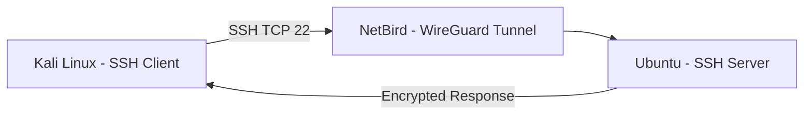

# 05 | SSH-Konfiguration

**Projekt:** PurpleShield – Cybersecurity HomeLab  
**Projektphase:** Sichere Remote-Administration  
**Status:** Abgeschlossen  

---

## 1. Zielsetzung

Ziel dieser Projektphase ist die Einrichtung einer verschlüsselten Remote-Verbindung zwischen Kali Linux und Ubuntu Desktop.

Die Authentifizierung erfolgt mithilfe eines kryptografischen Schlüsselpaars anstelle einer herkömmlichen Passwortanmeldung.

Die Kommunikation findet innerhalb des privaten NetBird-Netzwerks statt.

## 2. Was ist SSH?

SSH (Secure Shell) ist ein Netzwerkprotokoll zur verschlüsselten Kommunikation und Remote-Administration von Computersystemen.

SSH verwendet standardmäßig den TCP-Port 22.

### Einsatzbereiche

- Remote-Administration
- Sichere Dateiübertragung
- Ausführung von Terminalbefehlen
- Serververwaltung
- Automatisierung
- Verschlüsselte Netzwerkkommunikation

## 3. Technische Grundlagen

| Begriff | Beschreibung |
|---|---|
| SSH | Secure Shell |
| OpenSSH | Open-Source-Implementierung des SSH-Protokolls |
| Public Key | Öffentlicher kryptografischer Schlüssel |
| Private Key | Privater kryptografischer Schlüssel |
| ED25519 | Digitales Signaturverfahren |
| Passphrase | Zusätzlicher Schutz des privaten Schlüssels |
| TCP-Port 22 | Standardport für SSH |
| Authentication | Überprüfung der Identität eines Benutzers |

## 4. Netzwerkarchitektur



Kali Linux übernimmt die Rolle des SSH-Clients.

Ubuntu Desktop stellt den SSH-Server bereit.

NetBird ermöglicht die private und verschlüsselte Netzwerkverbindung zwischen beiden Systemen.

## 5. Installation des SSH-Servers

Auf dem Ubuntu-System wird OpenSSH Server installiert.

```bash
sudo apt update
sudo apt install openssh-server
```

### SSH-Dienst aktivieren

```bash
sudo systemctl enable --now ssh
```

### Dienststatus überprüfen

```bash
sudo systemctl status ssh
```

### SSH-Port überprüfen

```bash
sudo ss -tlnp
```

Der SSH-Dienst verwendet standardmäßig TCP-Port 22.

## 6. SSH-Schlüsselpaar erstellen

Auf dem Kali-Linux-System wird ein ED25519-Schlüsselpaar erstellt.

```bash
ssh-keygen -t ed25519 -C "purpleshield-lab"
```

Dabei werden zwei Dateien erzeugt:

| Datei | Funktion |
|---|---|
| ~/.ssh/id_ed25519 | Privater Schlüssel |
| ~/.ssh/id_ed25519.pub | Öffentlicher Schlüssel |

Der private Schlüssel verbleibt ausschließlich auf dem Client-System.

Der öffentliche Schlüssel wird auf dem Zielsystem hinterlegt.

Eine Passphrase schützt den privaten Schlüssel zusätzlich vor unbefugter Verwendung.

## 7. Public-Key-Authentifizierung

Der öffentliche Schlüssel kann mit folgendem Befehl auf das Ubuntu-System übertragen werden:

```bash
ssh-copy-id -i ~/.ssh/id_ed25519.pub LAB_USER@UBUNTU_PEER_IP
```

LAB_USER und UBUNTU_PEER_IP sind anonymisierte Platzhalter.

Auf dem Ubuntu-System wird der öffentliche Schlüssel in folgender Datei gespeichert:

```text
~/.ssh/authorized_keys
```

Bei der Anmeldung weist der Client durch eine kryptografische Signatur nach, dass er über den passenden privaten Schlüssel verfügt.

Der private Schlüssel wird dabei nicht über das Netzwerk übertragen.

## 8. Dateiberechtigungen

Korrekte Dateiberechtigungen sind für die sichere Verwendung von SSH-Schlüsseln erforderlich.

### Auf dem Client-System

```bash
chmod 700 ~/.ssh
chmod 600 ~/.ssh/id_ed25519
chmod 644 ~/.ssh/id_ed25519.pub
```

### Auf dem Server-System

```bash
chmod 700 ~/.ssh
chmod 600 ~/.ssh/authorized_keys
```

| Berechtigung | Bedeutung |
|---|---|
| 700 | Vollzugriff ausschließlich für den Eigentümer |
| 600 | Lesen und Schreiben ausschließlich für den Eigentümer |
| 644 | Eigentümer darf schreiben, andere dürfen lesen |

## 9. SSH-Verbindung herstellen

```bash
ssh -i ~/.ssh/id_ed25519 LAB_USER@UBUNTU_PEER_IP
```

Für die gezielte Überprüfung der Public-Key-Authentifizierung wurde folgende Befehlsstruktur verwendet:

```bash
ssh -i ~/.ssh/id_ed25519 \
-o PreferredAuthentications=publickey \
-o PasswordAuthentication=no \
LAB_USER@UBUNTU_PEER_IP
```

### Erklärung der Parameter

| Parameter | Funktion |
|---|---|
| -i | Gibt den privaten Schlüssel an |
| PreferredAuthentications=publickey | Verwendet Public-Key-Authentifizierung |
| PasswordAuthentication=no | Deaktiviert die Passwortauthentifizierung für diesen Client-Aufruf |
| LAB_USER | Benutzerkonto auf dem Zielsystem |
| UBUNTU_PEER_IP | NetBird-Adresse des Zielsystems |

## 10. Verbindungsergebnis

Die SSH-Verbindung zwischen Kali Linux und Ubuntu wurde erfolgreich hergestellt.

Anonymisierte Darstellung der erfolgreichen Anmeldung:

```text
Enter passphrase for key '~/.ssh/id_ed25519':

Welcome to Ubuntu 24.04 LTS

LAB_USER@UBUNTU-LAB:~$
```

Die erfolgreiche Anmeldung bestätigt, dass die Public-Key-Authentifizierung funktioniert.

Die angeforderte Passphrase dient der Entschlüsselung des lokalen privaten Schlüssels und ist nicht das Benutzerpasswort des Ubuntu-Systems.

## 11. SSH-Konfigurationsdateien

| Datei | Funktion |
|---|---|
| /etc/ssh/sshd_config | Konfiguration des SSH-Servers |
| /etc/ssh/sshd_config.d/ | Zusätzliche Serverkonfigurationen |
| ~/.ssh/config | Benutzerbezogene Client-Konfiguration |
| ~/.ssh/authorized_keys | Autorisierte öffentliche Schlüssel |
| ~/.ssh/known_hosts | Bekannte SSH-Hostschlüssel |

## 12. Geplante SSH-Härtung

Für eine spätere Projektphase sind folgende serverseitige Einstellungen vorgesehen:

```text
PermitRootLogin no
PubkeyAuthentication yes
PasswordAuthentication no
KbdInteractiveAuthentication no
```

Vor der Deaktivierung der Passwortanmeldung muss sichergestellt werden, dass die Schlüsselauthentifizierung zuverlässig funktioniert.

### Konfiguration überprüfen

```bash
sudo sshd -t
```

### Effektive Konfiguration anzeigen

```bash
sudo sshd -T
```

### Dienstkonfiguration neu laden

```bash
sudo systemctl reload ssh
```

Eine bestehende SSH-Sitzung sollte während der Überprüfung geöffnet bleiben, um eine unbeabsichtigte Aussperrung zu vermeiden.

Diese serverseitigen Härtungsmaßnahmen sind noch nicht als abgeschlossen dokumentiert.

## 13. Fehleranalyse

### SSH-Verbindung detailliert untersuchen

```bash
ssh -vvv LAB_USER@UBUNTU_PEER_IP
```

### SSH-Dienst überprüfen

```bash
sudo systemctl status ssh
```

### SSH-Protokolle anzeigen

```bash
sudo journalctl -u ssh
```

### Mögliche Fehlerursachen

| Fehlermeldung | Mögliche Ursache |
|---|---|
| Connection refused | SSH-Dienst nicht aktiv |
| Connection timed out | Netzwerk- oder Firewallproblem |
| Permission denied | Authentifizierung fehlgeschlagen |
| Host key verification failed | Abweichender oder unbekannter Hostschlüssel |
| Bad permissions | Fehlerhafte Dateiberechtigungen |

Bei einer Änderung des Hostschlüssels muss dessen Identität vor einer erneuten Verbindung überprüft werden.

## 14. Testprotokoll

| ID | Test | Erwartetes Ergebnis | Status |
|---|---|---|---|
| SSH-01 | OpenSSH installieren | SSH-Dienst verfügbar | Bestanden |
| SSH-02 | TCP-Port 22 überprüfen | SSH-Port erreichbar | Bestanden |
| SSH-03 | ED25519-Schlüsselpaar erstellen | Schlüssel vorhanden | Bestanden |
| SSH-04 | Public Key hinterlegen | Schlüssel registriert | Bestanden |
| SSH-05 | SSH über NetBird | Verbindung erfolgreich | Bestanden |
| SSH-06 | Public-Key-Authentifizierung | Anmeldung erfolgreich | Bestanden |
| SSH-07 | Clientseitige Passwortauthentifizierung deaktivieren | Anmeldung per Schlüssel erfolgreich | Bestanden |
| SSH-08 | Serverseitige Passwortanmeldung deaktivieren | Passwortanmeldung blockiert | Geplant |
| SSH-09 | Root-Anmeldung deaktivieren | Root-Zugriff blockiert | Geplant |

## 15. Sicherheitskonzept

Folgende Sicherheitsmaßnahmen werden berücksichtigt:

- Verschlüsselte SSH-Kommunikation
- ED25519-Schlüsselauthentifizierung
- Schutz des privaten Schlüssels durch eine Passphrase
- Private Netzwerkkommunikation über NetBird
- Kontrolle der Dateiberechtigungen
- Überprüfung von SSH-Hostschlüsseln
- Keine unnötige öffentliche Bereitstellung des SSH-Dienstes
- Regelmäßige Sicherheitsaktualisierungen

Weitere Maßnahmen wie Fail2ban, Firewall-Regeln und serverseitige SSH-Härtung werden in späteren Projektphasen behandelt.

## 16. Datenschutz

Folgende Informationen werden nicht veröffentlicht:

- Private SSH-Schlüssel
- Passphrasen und Passwörter
- Tatsächliche IP-Adressen
- Persönliche Benutzernamen
- Individuelle Hostnamen
- Authentifizierungstoken
- Persönliche Systeminformationen

Alle veröffentlichten Terminalausgaben werden anonymisiert.

## 17. Erworbene Kompetenzen

- SSH-Client-Server-Architektur
- OpenSSH-Administration
- Asymmetrische Kryptografie
- ED25519-Schlüsselverwaltung
- Public-Key-Authentifizierung
- Linux-Dateiberechtigungen
- Dienstverwaltung mit systemctl
- Protokollanalyse mit journalctl
- Sichere Remote-Administration
- Systematische Fehlerdiagnose

## 18. Fazit

Durch die erfolgreiche Einrichtung von OpenSSH und der ED25519-Schlüsselauthentifizierung konnte eine sichere Remote-Verbindung zwischen Kali Linux und Ubuntu hergestellt werden.

Die Verbindung erfolgt innerhalb des privaten NetBird-Netzwerks.

Diese Projektphase bildet die Grundlage für die weitere Linux-Administration, Automatisierung und kontrollierte Sicherheitsanalyse innerhalb des PurpleShield HomeLabs.

---

[Zurück zur Projektübersicht](../README.md)

[Vorherige Phase – NetBird-Integration](04-netbird-setup.md)

**PurpleShield | Build. Secure. Test. Learn.**
