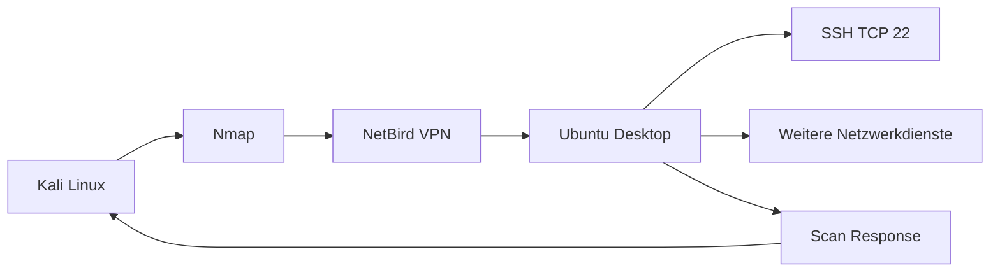
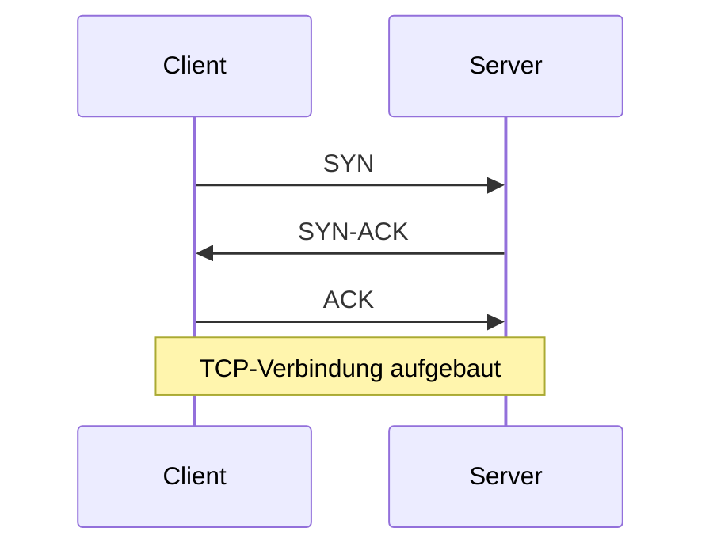

# 06 | Netzwerkanalyse mit Nmap

**Projekt:** PurpleShield – Cybersecurity HomeLab  
**Projektphase:** Netzwerk- und Sicherheitsanalyse  
**Status:** Grundlegende Analyse abgeschlossen  

---

## 1. Zielsetzung

Ziel dieser Projektphase ist die systematische Untersuchung der Netzwerkdienste innerhalb der eigenen virtuellen Laborumgebung.

Mithilfe von Nmap werden erreichbare Systeme, offene Ports und Netzwerkdienste identifiziert und hinsichtlich ihrer sicherheitstechnischen Bedeutung bewertet.

Die Ergebnisse dienen als Grundlage für spätere Maßnahmen zur Systemhärtung.

## 2. Was ist Nmap?

Nmap (Network Mapper) ist ein Open-Source-Werkzeug zur Netzwerkerkennung und Sicherheitsanalyse.

### Einsatzbereiche

- Erkennung erreichbarer Netzwerksysteme
- Analyse offener TCP- und UDP-Ports
- Identifikation von Netzwerkdiensten
- Erkennung von Dienstversionen
- Überprüfung von Firewall-Regeln
- Unterstützung bei Sicherheitsbewertungen
- Netzwerkdiagnose

## 3. Technische Umgebung

| Komponente | Funktion |
|---|---|
| Kali Linux | Analyse- und Scan-System |
| Ubuntu Desktop | Autorisiertes Zielsystem |
| NetBird | Privates Overlay-Netzwerk |
| WireGuard | Verschlüsselte Netzwerkkommunikation |
| Nmap | Netzwerk- und Portanalyse |
| OpenSSH | Remote-Administrationsdienst |

## 4. Netzwerkarchitektur



Die Netzwerkanalyse erfolgt ausschließlich innerhalb der eigenen autorisierten Laborumgebung.

## 5. Grundlagen der Portanalyse

Ein Port ist ein logischer Kommunikationsendpunkt innerhalb eines Betriebssystems.

Netzwerkdienste verwenden Ports, um eingehende und ausgehende Verbindungen bestimmten Anwendungen zuzuordnen.

### Bekannte Netzwerkports

| Port | Protokoll | Dienst |
|---|---|---|
| 21 | TCP | FTP |
| 22 | TCP | SSH |
| 23 | TCP | Telnet |
| 25 | TCP | SMTP |
| 53 | TCP/UDP | DNS |
| 80 | TCP | HTTP |
| 443 | TCP | HTTPS |
| 445 | TCP | SMB |
| 3389 | TCP | RDP |
| 51820 | UDP | Häufig WireGuard |

Die Portnummer allein ist kein eindeutiger Nachweis für einen bestimmten Dienst.

## 6. TCP und UDP

### TCP – Transmission Control Protocol

TCP ist ein verbindungsorientiertes Transportprotokoll.

Eigenschaften:

- Verbindungsaufbau mittels Three-Way Handshake
- Zuverlässige Datenübertragung
- Bestätigung empfangener Daten
- Wiederholung verlorener Datenpakete
- Geordnete Datenübertragung

Typische Anwendungen sind SSH, HTTP und HTTPS.

### UDP – User Datagram Protocol

UDP ist ein verbindungsloses Transportprotokoll.

Eigenschaften:

- Kein vorheriger Verbindungsaufbau
- Geringerer Protokollaufwand
- Keine garantierte Zustellung
- Keine garantierte Reihenfolge
- Keine integrierte Wiederholung verlorener Pakete

Typische Anwendungen sind DNS, Streaming und VPN-Kommunikation.

## 7. TCP Three-Way Handshake



Der Three-Way Handshake dient dem Aufbau einer TCP-Verbindung.

Dieses Verfahren ist eine wichtige Grundlage für das Verständnis verschiedener TCP-Scanmethoden.

## 8. Installation und Überprüfung

Nmap ist Bestandteil vieler Kali-Linux-Installationen.

Die installierte Version kann mit folgendem Befehl überprüft werden:

```bash
nmap --version
```

Falls Nmap nicht installiert ist:

```bash
sudo apt update
sudo apt install nmap
```

## 9. Vorbereitung der Netzwerkanalyse

Vor der Durchführung eines Scans wird die Netzwerkverbindung überprüft.

```bash
netbird status
ip a
ip route
```

Anschließend kann die Erreichbarkeit des Zielsystems getestet werden:

```bash
ping -c 4 UBUNTU_PEER_IP
```

UBUNTU_PEER_IP ist ein Platzhalter für die tatsächliche Adresse des autorisierten Ubuntu-Testsystems.

## 10. Nmap-Scanmethoden

Die folgenden Befehle dokumentieren geeignete Scanmethoden für die Laborumgebung.

### 10.1 Standardscan

```bash
nmap UBUNTU_PEER_IP
```

Überprüft standardmäßig häufig verwendete TCP-Ports.

### 10.2 Host Discovery

```bash
nmap -sn UBUNTU_PEER_IP
```

Überprüft die Erreichbarkeit eines Systems, ohne einen regulären Portscan durchzuführen.

### 10.3 TCP Connect Scan

```bash
nmap -sT UBUNTU_PEER_IP
```

Verwendet vollständige TCP-Verbindungsversuche zur Ermittlung des Portstatus.

### 10.4 TCP SYN Scan

```bash
sudo nmap -sS UBUNTU_PEER_IP
```

Analysiert TCP-Portzustände anhand der Antworten auf SYN-Pakete.

### 10.5 Service Version Detection

```bash
nmap -sV UBUNTU_PEER_IP
```

Versucht, die erreichbaren Netzwerkdienste und deren Versionen zu identifizieren.

### 10.6 UDP Scan

```bash
sudo nmap -sU --top-ports 100 UBUNTU_PEER_IP
```

Untersucht häufig verwendete UDP-Ports.

UDP-Scans können aufgrund fehlender Antworten und notwendiger Wartezeiten länger dauern als TCP-Scans.

### 10.7 Gezielte Portüberprüfung

```bash
nmap -p 22 -sV UBUNTU_PEER_IP
```

Überprüft gezielt den SSH-Port und versucht, den zugehörigen Dienst zu identifizieren.

## 11. Nmap-Portzustände

| Zustand | Bedeutung |
|---|---|
| open | Eine Anwendung akzeptiert Verbindungen oder Datenpakete |
| closed | Port erreichbar, aber kein Dienst lauscht |
| filtered | Portstatus aufgrund einer Filterung nicht eindeutig bestimmbar |
| unfiltered | Port erreichbar, Offen- oder Geschlossenzustand unbekannt |
| open\|filtered | Port möglicherweise offen oder gefiltert |
| closed\|filtered | Port möglicherweise geschlossen oder gefiltert |

Ein offener Port stellt nicht automatisch eine Sicherheitslücke dar.

Die Sicherheitsbewertung hängt unter anderem vom Dienst, seiner Konfiguration, seiner Version und den Zugriffsberechtigungen ab.

## 12. Tatsächliche Scanergebnisse

Bei der bisherigen Untersuchung des Ubuntu-Testsystems wurden folgende Portzustände festgestellt.

Die Ergebnisse werden ohne persönliche IP-Adressen und Hostnamen dokumentiert.

| Port | Protokoll | Zustand | Bewertung |
|---|---|---|---|
| 22 | TCP | open | OpenSSH erreichbar |
| 53 | UDP | open | DNS-Port erreichbar |
| 51820 | UDP | open\|filtered | Zustand nicht eindeutig bestimmbar |

### Identifizierter SSH-Dienst

```text
PORT     STATE    SERVICE    VERSION
22/tcp   open     ssh        OpenSSH 9.6p1
```

### UDP-Ergebnisse

```text
PORT        STATE
53/udp      open
51820/udp   open|filtered
```

Die Darstellung enthält die relevanten Ergebnisse in anonymisierter und gekürzter Form.

## 13. Interpretation der Ergebnisse

### TCP-Port 22 – SSH

Der SSH-Dienst wurde bewusst für die Remote-Administration eingerichtet.

Die Erreichbarkeit des Dienstes entspricht der vorgesehenen Funktion der Laborumgebung.

Sicherheitsmaßnahmen:

- ED25519-Schlüsselauthentifizierung
- Schutz des privaten Schlüssels durch eine Passphrase
- Kommunikation innerhalb des privaten NetBird-Netzwerks
- Geplante serverseitige SSH-Härtung

### UDP-Port 53 – DNS

Port 53 wird typischerweise für die Namensauflösung verwendet.

Die genaue Zuordnung des erreichbaren Dienstes muss durch eine lokale Prozess- und Schnittstellenanalyse bestätigt werden.

### UDP-Port 51820

Port 51820 wird häufig im Zusammenhang mit WireGuard verwendet.

Der Zustand open|filtered bedeutet jedoch nicht, dass ein aktiver WireGuard-Dienst eindeutig nachgewiesen wurde.

Eine weiterführende lokale Überprüfung ist erforderlich.

## 14. Lokale Dienstüberprüfung

Zur Gegenprüfung der Scanergebnisse können auf dem Ubuntu-System folgende Befehle eingesetzt werden:

```bash
sudo ss -tulnp
```

Der Befehl zeigt lauschende TCP- und UDP-Sockets sowie zugehörige Prozesse an.

Weitere Diagnosebefehle:

```bash
sudo systemctl status ssh
sudo systemctl status netbird
netbird status --detail
```

### Bedeutung der ss-Parameter

| Parameter | Funktion |
|---|---|
| -t | TCP-Sockets anzeigen |
| -u | UDP-Sockets anzeigen |
| -l | Lauschende Sockets anzeigen |
| -n | Numerische Adressen und Ports anzeigen |
| -p | Zugehörige Prozesse anzeigen |

Die Kombination aus externer Portanalyse und lokaler Dienstüberprüfung ermöglicht eine zuverlässigere Bewertung der Netzwerkdienste.

## 15. Sicherheitsbewertung

| Feststellung | Bewertung | Maßnahme |
|---|---|---|
| SSH erreichbar | Vorgesehener Administrationsdienst | SSH weiter absichern |
| DNS-Port erreichbar | Dienstzuordnung erforderlich | Prozess und Bind-Adresse prüfen |
| UDP 51820 open\|filtered | Keine eindeutige Aussage | Lokale Überprüfung durchführen |
| Verschlüsselte Kommunikation | Sicherheitsmaßnahme vorhanden | Regelmäßig überprüfen |
| Individuelle Firewall-Regeln | Weitere Umsetzung vorgesehen | Zugriff gezielt beschränken |

Die Ergebnisse stellen eine grundlegende Bestandsaufnahme und keine vollständige Schwachstellenanalyse dar.

## 16. Testprotokoll

| ID | Test | Ergebnis |
|---|---|---|
| NM-01 | Erreichbarkeit des Ubuntu-Systems | Bestanden |
| NM-02 | TCP-Portanalyse | Bestanden |
| NM-03 | SSH-Dienst erkennen | Bestanden |
| NM-04 | SSH-Version identifizieren | Bestanden |
| NM-05 | UDP-Portanalyse | Durchgeführt |
| NM-06 | UDP-Dienste eindeutig zuordnen | Weiterführende Prüfung erforderlich |
| NM-07 | Firewall-Regeln überprüfen | Geplant |
| NM-08 | Erneuter Scan nach Systemhärtung | Geplant |

## 17. Geplante Erweiterungen

- Vergleich von Scanergebnissen vor und nach der Systemhärtung
- Überprüfung von Firewall-Regeln
- Analyse des Netzwerkverkehrs mit Wireshark
- Weiterführende Dienstidentifikation
- Dokumentation potenzieller Schwachstellen
- Erstellung eines technischen Sicherheitsberichts

## 18. Sicherheit und Datenschutz

Alle Netzwerkscans werden ausschließlich auf eigenen und ausdrücklich autorisierten Testsystemen durchgeführt.

Folgende Informationen werden nicht veröffentlicht:

- Persönliche IP-Adressen
- MAC-Adressen
- Individuelle Hostnamen
- Zugangsdaten
- Private Schlüssel
- Authentifizierungstoken
- Vertrauliche Netzwerkkonfigurationen

## 19. Erworbene Kompetenzen

- Netzwerk- und Portanalyse
- TCP- und UDP-Kommunikation
- TCP Three-Way Handshake
- Nmap-Scanmethoden
- Interpretation von Portzuständen
- Dienst- und Versionserkennung
- Linux-Prozessanalyse
- Sicherheitstechnische Bewertung
- Erstellung technischer Testprotokolle

## 20. Fazit

Durch die Netzwerkanalyse mit Nmap konnte ich erreichbare Netzwerkdienste innerhalb meiner virtuellen Laborumgebung identifizieren.

Besonders wichtig war die Unterscheidung zwischen offenen Ports, gefilterten Ports und tatsächlich nachgewiesenen Sicherheitslücken.

Die bisherigen Ergebnisse bilden eine technische Ausgangsbasis für die weitere Systemhärtung und die spätere Überprüfung von Sicherheitsmaßnahmen.

---

[Zurück zur Projektübersicht](../README.md)

[Vorherige Phase – SSH-Konfiguration](05-ssh-configuration.md)

**PurpleShield | Build. Secure. Test. Learn.**
