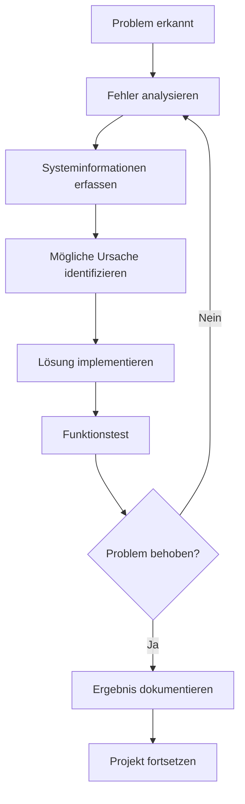

# 07 | Fehleranalyse und Troubleshooting

**Projekt:** PurpleShield – Cybersecurity HomeLab  
**Projektphase:** Technische Fehleranalyse und Qualitätssicherung  
**Status:** Fortlaufende Dokumentation  

---

## 1. Zielsetzung

Ziel dieser Dokumentation ist die systematische Erfassung, Analyse und Behebung technischer Probleme innerhalb der virtuellen Laborumgebung.

Dabei werden aufgetretene Fehler, mögliche Ursachen, eingesetzte Diagnosewerkzeuge und umgesetzte Lösungsmaßnahmen nachvollziehbar dokumentiert.

## 2. Methodisches Vorgehen

Die Fehleranalyse erfolgt nach einem strukturierten Verfahren:

1. Problem identifizieren
2. Fehlerbeschreibung erstellen
3. Systeminformationen erfassen
4. Mögliche Ursachen eingrenzen
5. Diagnosewerkzeuge einsetzen
6. Lösungsmaßnahmen durchführen
7. Funktion erneut überprüfen
8. Ergebnisse dokumentieren

## 3. Troubleshooting-Prozess



## 4. Incident PS-001 – Bildschirmauflösung

### Fehlerbeschreibung

Nach der Installation von Kali Linux wurde die virtuelle Maschine nicht vollständig an die Bildschirmgröße des Host-Systems angepasst.

Die Darstellung erforderte teilweise horizontales oder vertikales Scrollen.

### Betroffene Komponenten

- Oracle VirtualBox
- Kali Linux
- Virtuelle Grafikkonfiguration
- Guest Additions

### Fehleranalyse

Folgende Bereiche wurden untersucht:

- Bildschirmauflösung des Gastbetriebssystems
- Virtuelle Anzeigeeinstellungen
- Automatische Größenanpassung
- Guest Additions
- VirtualBox-Anzeigemodus

### Diagnosebefehle

Geeignete Befehle zur Untersuchung der grafischen Umgebung:

```bash
xrandr
lsmod | grep vbox
```

### Lösung

Die Anzeigeeinstellungen innerhalb der virtuellen Umgebung wurden angepasst.

Nach mehreren Konfigurationsversuchen konnte eine nutzbare Bildschirmdarstellung hergestellt werden.

Die genaue Kombination der erfolgreichen Einstellungen wurde zum Zeitpunkt der Fehlerbehebung nicht vollständig protokolliert.

### Ergebnis

| Kriterium | Ergebnis |
|---|---|
| Virtuelle Maschine startet | Erfolgreich |
| Bildschirmdarstellung | Funktionsfähig |
| Bedienbarkeit | Wiederhergestellt |
| Status | Behoben |

### Lernergebnis

Die Integration zwischen Host- und Gastbetriebssystem hängt unter anderem von virtuellen Grafiktreibern, Anzeigeeinstellungen und zusätzlichen Integrationskomponenten ab.

## 5. Incident PS-002 – Fehlende Netzwerkverbindung

### Fehlerbeschreibung

Nach der Einrichtung von Kali Linux war zunächst keine funktionsfähige Internetverbindung vorhanden.

Eine Netzwerkschnittstelle war nicht verbunden, während eine weitere Schnittstelle dem Host-only-Netzwerk zugeordnet war.

### Betroffene Komponenten

- VirtualBox-Netzwerkadapter
- Kali Linux
- NetworkManager
- IPv4-Konfiguration
- NAT

### Fehleranalyse

Zur Untersuchung der Netzwerkkonfiguration wurden folgende Werkzeuge verwendet:

```bash
ip a
ip route
nmcli device status
nmcli connection show
```

### Anonymisierte Ausgangssituation

| Schnittstelle | Funktion | Zustand |
|---|---|---|
| eth0 | Netzwerkzugriff über NAT | Disconnected |
| eth1 | Host-only-Netzwerk | IP-Adresse vorhanden |

### Fehlerursache

Die für den Internetzugriff benötigte Netzwerkschnittstelle war nicht aktiv verbunden.

Das Host-only-Netzwerk allein stellte keinen regulären Internetzugriff bereit.

### Lösungsmaßnahme

Die Netzwerkverbindung wurde mithilfe von NetworkManager wiederhergestellt.

Beispiel für die Aktivierung der betroffenen Schnittstelle:

```bash
sudo nmcli device connect eth0
```

Anschließend wurde die Netzwerkkonfiguration erneut überprüft.

```bash
ip a
ip route
nmcli device status
```

### Funktionstest

Ein erfolgreicher Ping-Test bestätigte die wiederhergestellte Netzwerkkommunikation.

### Ergebnis

| Kriterium | Ergebnis |
|---|---|
| Netzwerkschnittstelle erkannt | Erfolgreich |
| Netzwerkverbindung hergestellt | Erfolgreich |
| Konnektivität wiederhergestellt | Erfolgreich |
| Status | Behoben |

### Lernergebnis

Eine vorhandene IP-Adresse bedeutet nicht automatisch, dass ein System über eine funktionsfähige Internetverbindung verfügt.

Netzwerkschnittstellen, Routing, Gateway und Netzwerkmodus müssen gemeinsam betrachtet werden.

## 6. Prüfpunkt PS-003 – SSH-Authentifizierung

### Ausgangssituation

Für die Remote-Administration des Ubuntu-Systems sollte eine Anmeldung mittels ED25519-Schlüsselauthentifizierung eingerichtet werden.

Dabei musste überprüft werden, ob die Verbindung tatsächlich über den kryptografischen Schlüssel und nicht über das Benutzerpasswort hergestellt wird.

### Überprüfung

```bash
ssh -i ~/.ssh/id_ed25519 \
-o PreferredAuthentications=publickey \
-o PasswordAuthentication=no \
LAB_USER@UBUNTU_PEER_IP
```

### Ergebnis

Die Anmeldung wurde erfolgreich durchgeführt.

Die Passphrase des lokalen privaten Schlüssels wurde abgefragt und anschließend eine SSH-Sitzung auf dem Ubuntu-System aufgebaut.

### Sicherheitsbewertung

Der Test bestätigt die erfolgreiche Public-Key-Authentifizierung.

Er bestätigt jedoch nicht, dass die Passwortauthentifizierung serverseitig deaktiviert wurde.

Die serverseitige SSH-Härtung bleibt Bestandteil einer späteren Projektphase.

### Lernergebnis

Zwischen einer clientseitigen Einschränkung der Authentifizierungsmethode und einer serverseitigen Sicherheitsrichtlinie muss unterschieden werden.

## 7. Prüfpunkt PS-004 – Uneindeutige UDP-Scanergebnisse

### Ausgangssituation

Bei der Netzwerkanalyse mit Nmap wurden unter anderem folgende Portzustände festgestellt:

| Port | Protokoll | Zustand |
|---|---|---|
| 22 | TCP | open |
| 53 | UDP | open |
| 51820 | UDP | open/filtered |

### Analyse

Der Zustand open/filtered erlaubt keine eindeutige Aussage darüber, ob ein UDP-Port tatsächlich geöffnet ist oder durch eine Filterregel beeinflusst wird.

UDP-Port 51820 wird häufig für WireGuard verwendet.

Die Portnummer allein reicht jedoch nicht aus, um einen bestimmten Dienst eindeutig nachzuweisen.

### Geplante Gegenprüfung

```bash
sudo ss -tulnp
netbird status --detail
sudo systemctl status netbird
```

Durch die Kombination aus Portscan und lokaler Prozessanalyse sollen die erreichbaren Dienste eindeutig zugeordnet werden.

### Ergebnis

| Kriterium | Status |
|---|---|
| TCP-Portanalyse | Abgeschlossen |
| UDP-Portanalyse | Durchgeführt |
| Eindeutige UDP-Dienstzuordnung | Offen |
| Weiterführende Prüfung | Geplant |

### Lernergebnis

Ein Scanergebnis muss technisch interpretiert und durch weitere Diagnoseverfahren überprüft werden.

Ein offener Port ist nicht automatisch eine Sicherheitslücke.

## 8. Diagnosewerkzeuge

| Werkzeug | Einsatzbereich |
|---|---|
| ip a | Netzwerkschnittstellen und IP-Adressen |
| ip route | Routing-Tabelle |
| nmcli | Netzwerkverbindungen |
| ping | ICMP-Erreichbarkeit |
| getent | Namensauflösung |
| ss | Netzwerk-Sockets und Prozesse |
| systemctl | Dienstverwaltung |
| journalctl | System- und Dienstprotokolle |
| nmap | Netzwerk- und Portanalyse |
| ssh -vvv | Detaillierte SSH-Diagnose |
| netbird status | VPN-Verbindungsstatus |
| xrandr | Bildschirmkonfiguration |
| free -h | Arbeitsspeicherauslastung |
| df -h | Datenträgerauslastung |

## 9. Fehleranalyse anhand des OSI-Modells

| Schicht | Mögliche Fehlerursache | Diagnose |
|---|---|---|
| Layer 1 – Physical | Virtueller Adapter deaktiviert | VirtualBox-Einstellungen |
| Layer 2 – Data Link | Schnittstelle nicht verbunden | ip link |
| Layer 3 – Network | Fehlerhafte IP-Adresse oder Route | ip a, ip route |
| Layer 4 – Transport | Port nicht erreichbar | ss, nmap |
| Layer 5 – Session | Fehler beim Sitzungsaufbau | Verbindungsprotokolle |
| Layer 6 – Presentation | Verschlüsselungsprobleme | SSH-Debug-Ausgabe |
| Layer 7 – Application | Dienst oder Anwendung fehlerhaft | systemctl, journalctl |

Das OSI-Modell dient als Orientierung zur strukturierten Eingrenzung von Netzwerkproblemen.

## 10. Incident-Übersicht

| ID | Problem oder Prüfpunkt | Status |
|---|---|---|
| PS-001 | Bildschirmauflösung | Behoben |
| PS-002 | Fehlende Netzwerkverbindung | Behoben |
| PS-003 | SSH-Schlüsselauthentifizierung | Erfolgreich geprüft |
| PS-004 | Uneindeutige UDP-Portzustände | Weitere Prüfung geplant |

## 11. Präventive Maßnahmen

Für die weitere Entwicklung der Laborumgebung sind folgende Maßnahmen vorgesehen:

- Snapshots vor kritischen Systemänderungen
- Regelmäßige Datensicherung
- Dokumentation von Konfigurationsänderungen
- Systematische Funktionstests
- Regelmäßige Sicherheitsaktualisierungen
- Überprüfung aktiver Netzwerkdienste
- Kontrolle von Zugriffsberechtigungen
- Sichere Verwaltung kryptografischer Schlüssel
- Schrittweise Implementierung neuer Komponenten

## 12. Lessons Learned

Die bisherigen Projektphasen haben gezeigt, dass technische Probleme häufig durch das Zusammenspiel mehrerer Komponenten entstehen.

Besonders wichtige Erkenntnisse:

- Fehlermeldungen müssen sorgfältig analysiert werden.
- Änderungen sollten schrittweise durchgeführt werden.
- Nach jeder Änderung sollte ein Funktionstest erfolgen.
- Vermutungen müssen durch technische Ergebnisse überprüft werden.
- Funktionalität und Sicherheit sind getrennt zu bewerten.
- Nicht eindeutig bestätigte Ergebnisse müssen als offen dokumentiert werden.
- Eine nachvollziehbare Dokumentation erleichtert spätere Fehleranalysen.

## 13. Sicherheit und Datenschutz

Alle Untersuchungen werden ausschließlich innerhalb der eigenen, autorisierten Laborumgebung durchgeführt.

Terminalausgaben und Konfigurationsbeispiele werden vor der Veröffentlichung anonymisiert.

Zugangsdaten, private Schlüssel, persönliche Netzwerkadressen und vertrauliche Systeminformationen werden nicht veröffentlicht.

## 14. Erworbene Kompetenzen

- Systematische Fehleranalyse
- Root Cause Analysis
- Linux-Troubleshooting
- Netzwerkdiagnose
- Virtualisierungsmanagement
- Dienst- und Prozessanalyse
- Interpretation technischer Testergebnisse
- Qualitätssicherung
- Technische Dokumentation
- Eigenständige Problemlösung

## 15. Fazit

Die bisherige Entwicklung des PurpleShield HomeLabs hat mir ermöglicht, theoretische Kenntnisse mit praktischer Systemadministration und technischer Fehleranalyse zu verbinden.

Aufgetretene Probleme wurden untersucht und teilweise durch gezielte Konfigurationsänderungen behoben.

Noch offene Prüfpunkte werden in zukünftigen Projektphasen weiter untersucht.

Die kontinuierliche Dokumentation unterstützt die Weiterentwicklung einer nachvollziehbaren, erweiterbaren und sicherheitsorientierten IT-Infrastruktur.

---

[Zurück zur Projektübersicht](../README.md)

[Vorherige Phase – Netzwerkanalyse](06-network-scanning.md)

**PurpleShield | Build. Secure. Test. Learn.**

> Every problem is an opportunity to understand the system better.
